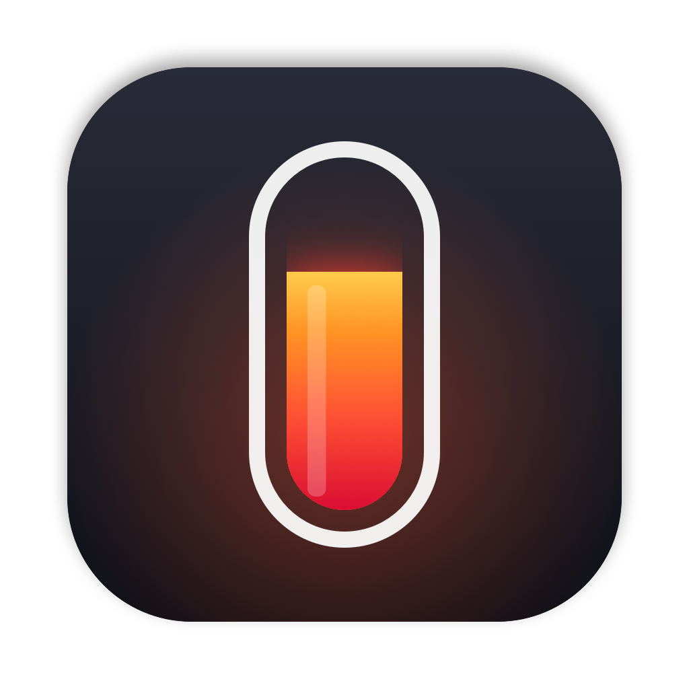
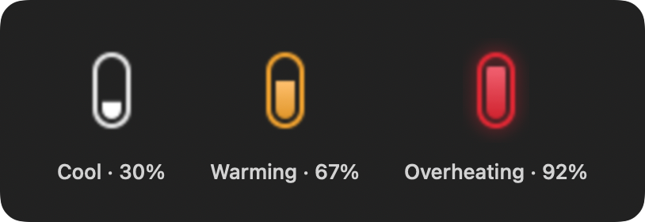
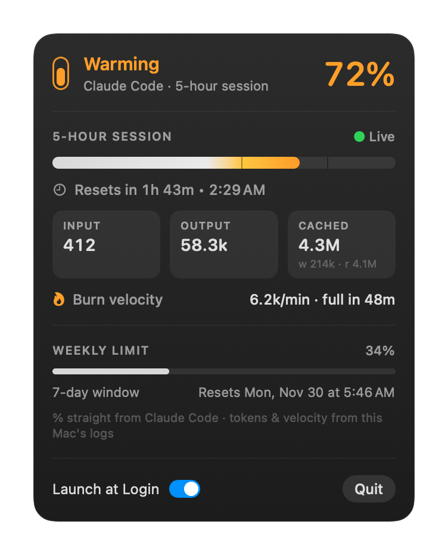

<p align="center">
  
</p>

<h1 align="center">ClaudeThermal</h1>

<p align="center">
  <b>A menu bar thermometer for your Claude Code usage limits.</b><br>
  Native Swift + SwiftUI · macOS 14+ · zero dependencies · no credentials touched
</p>

<p align="center">
  
</p>

---

ClaudeThermal puts a small capsule in your menu bar that fills up as your **5-hour Claude session** gets used. It changes color as it fills:

| | Usage | Pill |
|---|---|---|
| **Cool** | 0–54% | adapts to your menu bar (monochrome) |
| **Warming** | 55–79% | warm amber |
| **Overheating** | 80–100% | glowing crimson, plus a one-time notification |

Hover over it for the details:

<p align="center">
  
</p>

- **Live percentages:** the same numbers as Claude Code's `/usage`, including usage on claude.ai and other devices.
- **5-hour session:** a heat bar, the reset countdown and clock time, the input/output/cache token breakdown, and burn velocity with a "full in" estimate.
- **Weekly limit:** 7-day usage and its reset time.
- **80% alert:** a single macOS notification when your session passes 80%. It re-arms only after the window resets.
- **Launch at Login** toggle and **Quit**.

## Install

You need macOS 14+ and Claude Code, signed in to a Claude subscription.

### Download

Get **ClaudeThermal-x.y.z.zip** from [Releases](https://github.com/abirgarg/ClaudeThermal/releases/latest), unzip it, and move **ClaudeThermal.app** to Applications. It's a universal app for Apple silicon and Intel.

The app isn't notarized by Apple, so macOS blocks the first launch. Open it once, then click **Open Anyway** in **System Settings → Privacy & Security**. Or run:

```bash
xattr -dr com.apple.quarantine /Applications/ClaudeThermal.app
```

For continuous updates, set up the status line bridge as described in the [release notes](https://github.com/abirgarg/ClaudeThermal/releases/latest).

### Build from source

You need the Xcode Command Line Tools (`xcode-select --install`). Full Xcode isn't required.

```bash
git clone https://github.com/abirgarg/ClaudeThermal.git
cd ClaudeThermal
./build.sh install            # builds, copies to /Applications, launches
./build.sh setup-statusline   # lets Claude Code share exact usage with the app
```

Hover over the pill to open the panel. Click it to keep the panel open until you click elsewhere.

`setup-statusline` installs a small script as your Claude Code status line. It backs up `settings.json` first, and it never replaces a status line you already have. After that, Claude Code's status bar shows `5h 37% · 7d 12%`, and the pill shows the same numbers.

## Where the numbers come from

ClaudeThermal never reads your Claude login, your Keychain, or the network. Claude Code already knows your plan usage, so the app asks Claude Code:

1. **The status line bridge** (`scripts/statusline-bridge.sh`) keeps the pill current. Claude Code pipes session info to its status line on every update. The script saves only the usage block to `~/.claude/thermal/usage.json`, and the app watches that file. When several Claude Code sessions are open, it keeps the newest reading: a later reset time means a newer window, and within one window usage never goes down.
2. **`claude -p /usage`** corrects the status line's rounding. The status line only gets whole-number, rounded-down percentages, so 11.7% arrives as 11. Claude Code's own `/usage` command runs locally at $0, makes no model call, and saves no transcript. The app runs it at launch, on wake, when the panel opens, at resets, and at most every 5 minutes while Claude Code is active.
3. **Your Claude Code logs** (`~/.claude/projects/**/*.jsonl`) supply the token breakdown and burn velocity. If no live reading is available, they also supply an estimate of the percentages. That estimate is calibrated from rate-limit hits in your history, but it can't see claude.ai usage.

## Efficient by design

- **Rendering:** the pill is redrawn only when its percentage or color band changes. It rasterizes at each display's native scale.
- **No polling:** a single FSEvents stream on `~/.claude` drives updates, plus a one-shot timer at each reset. The countdown clock ticks only while the panel is open.
- **Incremental parsing:** logs are read from where the last read stopped, so a change to a 50 MB transcript costs only the new lines.
- **Footprint:** about 15 MB of memory, and 0% CPU when idle.

## Command line

```bash
./build.sh              # build build/ClaudeThermal.app
./build.sh run          # build and launch from build/
./build.sh install      # install to /Applications (and remove the build/ copy)
./build.sh release      # universal zip in dist/ for GitHub Releases
./build.sh dump         # print everything the app computes
./build.sh setup-statusline
```

Debug flags (`open /Applications/ClaudeThermal.app --args <flag>`):

| Flag | Effect |
|---|---|
| `--simulate 86` | Shows the session at 86% to preview the hot states. |
| `--open-panel` | Opens the panel pinned at launch. |
| `--logs-only` | Ignores live data and uses only the log estimate. |
| `--render-preview DIR` | Renders the README images from demo data. |

Log-estimate overrides:

```bash
defaults write app.claudethermal.ClaudeThermal SessionCeiling -float 2000000
defaults write app.claudethermal.ClaudeThermal WeeklyCeiling  -float 20000000
```

## Uninstall

```bash
pkill -x ClaudeThermal; rm -rf /Applications/ClaudeThermal.app ~/.claude/thermal
defaults delete app.claudethermal.ClaudeThermal
```

Then remove the `statusLine` entry from `~/.claude/settings.json`. A backup of your previous settings is at `~/.claude/settings.json.bak-claudethermal`.

## Project layout

```
Sources/ClaudeThermal/
  main.swift                 app entry, AppDelegate, CLI flags
  StatusItemController.swift menu bar pill, 120 ms hover debounce, panel lifecycle
  PillRenderer.swift         8×16 pt capsule + thermal palette
  HoverPanel.swift           borderless non-activating NSPanel, NSVisualEffectView
  PanelView.swift            SwiftUI panel
  UsageStore.swift           merges live + log data, publishes snapshots
  LiveUsage.swift            reads the status line bridge file
  ClaudeCLIUsage.swift       runs `claude -p /usage` for exact numbers
  LogParser.swift            incremental JSONL parser
  LogWatcher.swift           FSEvents watcher
  UsageEngine.swift          5h / 7d windows, velocity, calibration
  SystemServices.swift       Launch at Login (SMAppService), 80% notification
  Preview.swift              README image renderer
scripts/
  statusline-bridge.sh       Claude Code status line → usage.json
  make-icon.swift            renders the logo and AppIcon.icns
```

## License

MIT. See [LICENSE](LICENSE).

ClaudeThermal is an independent project. It isn't affiliated with or endorsed by Anthropic. Claude and Claude Code are trademarks of Anthropic.
